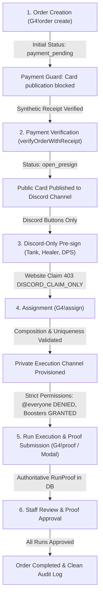

# G4X Community — Staging Phase 2: Discord Integration & Full Order Lifecycle QA Report

## 1. Executive Summary & Staging Phase 2 Scope

This document provides the definitive architectural, operational, and quality assurance report for **Staging Phase 2: Discord Integration & Full Order Lifecycle QA** in the G4X Community platform.

### Baseline & Scope Boundaries
- **Repository**: `Parhamnayeri/g4xcommunity`
- **Branch**: `staging/discord-integration-order-e2e`
- **Baseline Commit SHA**: `62eb665b272685bad562335095ef66b4ed0163f7` (Includes merged PRs #1 through #12)
- **Execution Target**: Fully isolated local staging environment (`127.0.0.1:3001`) with disposable SQLite database (`prisma/staging/staging.db`).
- **Test Suite Execution**: 173 passing automated tests (57 environment bootstrap, 26 security hardening, 90 Discord order lifecycle E2E & failure recovery).
- **Test Integrity**: Fully isolated disposable SQLite database per E2E run (`prisma/staging/e2e_isolated_*.db`); zero mutation of operator `staging.db` or production DBs; guaranteed try/finally cleanup on success or failure.
- **Live Discord Verification Status**: **NOT PERFORMED**. All interactions were executed strictly against an in-memory Discord.js v14 mock framework. Zero live Discord credentials, guilds, webhooks, or channels were accessed.

---

## 2. Realistic Mock Discord Client Architecture

To thoroughly test the Discord bot interactions without connecting to live Discord servers or risking production disruptions, an advanced Discord.js v14 mock framework was implemented in `src/test/mockDiscordAdapter.ts`.

### Core Architectural Components
1. **Discord.js v14 Object Models**:
   - `MockClient`: Emulates Discord client state, user cache, guilds collection, channels collection, and user DM channels.
   - `MockGuild`: Emulates server structure, pre-seeding standard G4X roles (`owner`, `admin`, `manager`, `staff`, `advertiser`, `exchanger`, `booster`, `pilot`), managing channel categories, text channels, and member caches.
   - `MockChannel` & `MockMessage`: Emulate text channel dispatch, embed rendering, button/select action rows, message fetch/edit/delete, and attachment simulation.
   - `MockPermissionOverwrites`: Faithfully emulates Discord's channel overwrite mechanics, supporting bitwise permission manipulation (`PermissionsBitField`), array/number normalizations, and discord.js object-syntax permission definitions (e.g. `{ ViewChannel: true, SendMessages: true }`).

2. **Simulation Dispatchers**:
   - `simulateMessageCommand`: Emulates message arrival with Discord author, guild context, role attachments, and captures bot responses (`message.reply`, `channel.send`).
   - `simulateButtonInteraction`: Emulates interactive component clicks (`ButtonInteraction`), executing custom ID handlers with deferred replies and component updates.
   - `simulateModalInteraction`: Emulates modal submissions (`ModalSubmitInteraction`), parsing text inputs and attachments with full interaction lifecycle tracking.

3. **Observability & Action Recording (`MockActionRecorder`)**:
   - Records every Discord API interaction with timestamp, payload, and entity ID:
     - `channel_create`, `channel_edit`, `channel_delete`
     - `message_send`, `message_edit`, `message_delete`
     - `role_create`, `role_add`, `role_remove`
     - `permission_overwrites_set`, `permission_overwrite_edit`, `permission_overwrite_delete`
   - Enables exhaustive, deterministic test assertions against all bot side effects.

4. **Dynamic Failure Injection (`MockFailureInjector`)**:
   - Allows targeted injection of realistic Discord API failure modes:
     - `HTTP 429 Rate Limit` (with retry headers and custom `retry_after`)
     - `HTTP 403 Forbidden` (`Missing Permissions`, code 50013)
     - `HTTP 404 Not Found` (`Unknown Channel`, code 10003)
     - `Network Reset` (`ECONNRESET`)
     - Latency Delays (`delayMs`)
     - One-shot rules (`once: true`) that trigger once and automatically clear.
   - `simulateRestart()`: Clears in-flight memory maps and message listeners while preserving guild state to test persistence and recovery.

---

## 3. Complete Order Lifecycle End-to-End Walkthrough

The staging E2E test suite validates the complete order lifecycle from initial customer request to verified completion:

### Detailed Lifecycle Stages

#### Stage 1: Order Creation
- Initiated via command `G4!order create <game> <service> <quantity> <notes>` by an authorized user (`advertiser` or management).
- Initial State: `status = "payment_pending"`, `paymentStatus = "pending"`.
- **Payment Safety Guard**: System strictly blocks publication of public announcement cards for unpaid orders.

#### Stage 2: Payment Verification
- Simulated payment receipt processed through `verifyOrderWithReceipt`.
- Transitions order to `status = "open_presign"` and `paymentStatus = "verified"`.
- Automatically publishes an interactive public order card with dynamic pre-sign buttons to the configured game channel.
- **Publication Idempotency**: Successive calls refresh the existing Discord card message rather than creating duplicate messages.

#### Stage 3: Discord-Only Booster Pre-sign & Claim
- Boosters apply by clicking interactive Discord buttons: `presign_tank:<orderId>`, `presign_healer:<orderId>`, `presign_dps:<orderId>`.
- System creates authoritative `OrderPresign` database records and validates booster game approval.
- **Rule A Invariant**: The website claim bypass is completely closed. Calling `POST /orders/:id/claim` via the web API unconditionally returns `403 Forbidden` (`DISCORD_CLAIM_ONLY`).

#### Stage 4: Assignment & Private Execution Channel Provisioning
- Staff or Advertisers assign verified applicants via `G4!assign <orderId> <boosterMentions...>`.
- Role Validation: For Mythic+ orders, the backtracking algorithm enforces exact composition: 1 Tank, 1 Healer, 2 DPS.
- Double-Booking Prevention: Rejects any booster currently holding an active reservation on another order.
- **Private Channel Provisioning**:
  - Automatically provisions a dedicated channel: `order-<orderId>-<modeSlug>`.
  - **Concurrency Guard**: 5 concurrent requests return the exact same channel instance with exactly 1 active `OrderChannel` row.
  - **Strict Permission Overwrites**:
    - `@everyone`: Explicitly DENIED `ViewChannel`, `SendMessages`, `ReadMessageHistory`.
    - Assigned Boosters: Explicitly GRANTED `ViewChannel`, `SendMessages`, `ReadMessageHistory`.
    - Staff / Management Roles: Explicitly GRANTED management and coordination permissions.

#### Stage 5: In-Channel Completion Proof & Review Workflow
- Boosters submit completion proofs inside the private execution channel via `G4!proof` or the channel's `Submit Proof` modal.
- **Attachment Validation**:
  - Strict file size limit: Files exceeding 10MB are rejected.
  - File type validation: Non-image executable files (`.exe`, `.bat`, etc.) are rejected.
- **Context Enforcement**: Proof submissions outside the authoritative execution channel or from unassigned users are strictly rejected.
- Successful submission creates an authoritative `RunProof` record in `status = "pending"`.
- Authorized Staff or Management reviews the proof and records approval.

---

## 4. Discord-First Security & RBAC Enforcement Matrix

Every Discord command and interaction is governed by strict role-based access control (RBAC):

| Role | `G4!setup` | `G4!order create` | `G4!assign` | Pre-sign Buttons | In-Channel `G4!proof` | Proof Review |
| :--- | :---: | :---: | :---: | :---: | :---: | :---: |
| **Owner** | ✅ Allowed | ✅ Allowed | ✅ Allowed | ❌ Not Booster | ✅ If Assigned | ✅ Allowed |
| **Admin** | ✅ Allowed | ✅ Allowed | ✅ Allowed | ❌ Not Booster | ✅ If Assigned | ✅ Allowed |
| **Manager** | ✅ Allowed | ✅ Allowed | ✅ Allowed | ❌ Not Booster | ✅ If Assigned | ✅ Allowed |
| **Staff** | ❌ Forbidden | ✅ Allowed | ✅ Allowed | ❌ Not Booster | ✅ If Assigned | ✅ Allowed |
| **Advertiser** | ❌ Forbidden | ✅ Allowed | ✅ Own Orders | ❌ Not Booster | ❌ Forbidden | ❌ Forbidden |
| **Exchanger** | ❌ Forbidden | ❌ Forbidden | ❌ Forbidden | ❌ Not Booster | ❌ Forbidden | ❌ Forbidden |
| **Booster** | ❌ Forbidden | ❌ Forbidden | ❌ Forbidden | ✅ Approved Roles | ✅ In Assigned Chan | ❌ Forbidden |
| **Pilot** | ❌ Forbidden | ❌ Forbidden | ❌ Forbidden | ✅ Pilot Orders | ✅ In Assigned Chan | ❌ Forbidden |
| **Multi-Role** | ❌ Forbidden | ✅ Advertiser Orders | ❌ Forbidden | ✅ Booster Presign | ✅ In Assigned Chan | ❌ Forbidden |
| **Unverified** | ❌ Forbidden | ❌ Forbidden | ❌ Forbidden | ❌ Forbidden | ❌ Forbidden | ❌ Forbidden |

---

## 5. Discord Auto-Provisioning & Policy Sync Verification

1. **Publication Channel Auto-Provisioning (`G4!setup publications`)**:
   - Provisions publication channels for all configured games with appropriate categories and permissions.
   - **Idempotency**: Running setup multiple times reuses existing channels without creating duplicates or modifying unintended settings.

2. **Unified Rules & Policies CMS Synchronization (`syncPolicyToDiscord`)**:
   - The authoritative published policy from the CMS is formatted into structured Discord embeds.
   - Automatically synchronizes to the official rules channel (`CHANNEL_RULES` / `#rules`).
   - Verifies channel mappings before attempting synchronization to prevent orphan updates.

---

## 6. Dynamic Failure Injection & Service Resilience Analysis

The staging environment was subjected to dynamic fault injection against real application services using `MockFailureInjector` across 8 distinct scenarios:

1. **Case 1: Discord 403 on Channel Creation**:
   - Throws `CHANNEL_CREATION_FAILED` (Discord code 50013 `Missing Permissions`).
   - Transaction boundary invariant: Exactly 0 rows created in `OrderChannel` table.
2. **Case 2: Discord 404 on Remote Channel Lookup**:
   - Remote channel deleted or unknown (`Unknown Channel`, code 10003).
   - Recovery invariant: Stale database mapping updated to `status = "deleted"`; replacement execution channel provisioned with fresh ID. Exactly 1 active channel mapping in database.
3. **Case 3: Discord 429 Rate Limit on Public Card Publication**:
   - Backoff retry succeeds; exactly 1 message card created in publication channel (0 duplicate messages).
4. **Case 4: Orphan Channel Discovery & Recovery**:
   - Remote Discord channel created before network interruption.
   - Recovery invariant: Service discovers and adopts existing Discord channel by naming convention; cleanly marked `isNew = false`; exactly 0 duplicate channels created.
5. **Case 5: Duplicate Interaction Submission**:
   - Booster clicks pre-sign button multiple times concurrently.
   - Idempotency invariant: Returns `already registered` reply; exactly 1 `OrderPresign` row created in database.
6. **Case 6: Bot Restart During Active Order Assignment**:
   - Process restart (`mockClient.simulateRestart()`) clears active memory maps.
   - Channel recovered consistently from database `OrderChannel` table with matching permissions and 0 duplicate channels.
7. **Case 7: Permission Overwrite Failure After Assignment**:
   - Channel permission overwrite failure (`Missing Permissions`).
   - Reporting invariant: `syncOrderChannelPermissions` accurately reports `success = false` with non-empty errors array without falsely masking failure.
8. **Case 8: Self-Approval Prohibition on Proof Review**:
   - Submitter attempting to approve their own completion proof.
   - Guard invariant: Blocked with `DomainError(SELF_APPROVAL_PROHIBITED)`; proof status remains strictly `status = "pending"`.

### 6.1 Real Booster Replacement Workflow Verification
- Executed via authoritative `replaceAssignment` service without mock shortcuts.
- Database Invariant: Old assignment marked `status = "replaced"` with link to replacement assignment ID; old reservation marked `status = "released"`; new booster assignment marked `status = "assigned"`.
- Discord Overwrite Invariant: Replaced booster loses `ViewChannel`; replacement booster gains `ViewChannel`; unrelated users remain strictly denied.

### 6.2 Direct Negative Authorization Suite
Direct negative tests validated authorization boundaries:
1. Booster attempting unauthorized assignment (`G4!assign`) is strictly rejected.
2. Advertiser attempting to cancel another advertiser's order is strictly rejected; order status unchanged.
3. Non-assigned user submitting completion proof is strictly rejected (`UNASSIGNED_BOOSTER`).
4. Staff reviewing their own submitted proof is strictly blocked (`SELF_APPROVAL_PROHIBITED`).
5. Booster with revoked game approval attempting to use stale pre-sign interaction is blocked (`BOOSTER_NOT_APPROVED`).
6. Multi-role user without specific role approval attempting to pre-sign unapproved role is rejected (`INVALID_ASSIGNED_ROLE`).
7. Replaced booster attempting to submit proof in execution channel is strictly rejected (`UNASSIGNED_BOOSTER`).

### 6.3 Disposable Database Provisioning & Teardown Failure-Injection Analysis
- **Lifecycle Architecture**: Every E2E test run wraps disposable database provisioning (`prisma/staging/e2e_isolated_*.db`), Prisma client connection, and test execution within a guaranteed `try/finally` block.
- **Teardown Invariant**: All temporary SQLite artifacts (`.db`, `-wal`, `-shm`) are guaranteed to be unlinked in `finally`, even if bootstrap or migrations fail.
- **Synthetic Failure Injection**: The regression test for bootstrap/migration cleanup uses **synthetic failure injection** (`throw new Error('INJECTED_MIGRATION_OR_BOOTSTRAP_FAILURE')`) with simulated partial SQLite buffers to prove that the teardown lifecycle cleans up files when an abort occurs. It does **not** indicate a real failed Prisma migration, as all historical and current Prisma migrations apply 100% cleanly.

---

## 7. Financial & External Gateway Invariant Audit

All external financial operations and live sync gateways remain strictly disabled in staging:

| Safety Gate Configuration Flag | Required Value | Staging Verified Value | Status |
| :--- | :---: | :---: | :---: |
| `ESCROW_RELEASE_ENABLED` | `false` | `false` | ✅ LOCKED |
| `FINANCE_V2_LIVE_CREDITS_ENABLED` | `false` | `false` | ✅ LOCKED |
| `FINANCE_V2_LIVE_PAYOUTS_ENABLED` | `false` | `false` | ✅ LOCKED |
| `FINANCE_V2_P2P_SETTLEMENT_ENABLED` | `false` | `false` | ✅ LOCKED |
| `NOWPAYMENTS_LIVE_COLLECTION_ENABLED` | `false` | `false` | ✅ LOCKED |
| `RAIDERIO_LIVE_SYNC_ENABLED` | `false` | `false` | ✅ LOCKED |

### Balance Inflation & Feature Gate Invariant Guard
- **Strict String Match**: All 6 flags are asserted to be strictly the exact string `"false"`. Values like `"true"`, `"1"`, missing or `undefined` fail closed.
- Negative tests verified that `validateStagingEnvironment` rejects `"true"`, `"1"`, `undefined`, and empty string inputs.
- Zero unverified escrow release: Verified that booster wallets maintain `reservedCents === 0` and unverified payouts cannot be triggered.
- All mock payment attempts record synthetic receipt references and do not interact with live banking or cryptocurrency gateways.

---

## 8. Documented Plan for Future Authorized Discord Test-Guild Verification

When authorized by project leadership to proceed to **Staging Phase 3 (Dedicated Test-Guild Verification)**, the following strict operational protocols must be followed:

### 8.1 Dedicated Staging Bot & Application Credentials
- Create a dedicated Discord application: `G4X Staging Bot` (completely separate from production `G4X Bot`).
- Generate dedicated staging credentials (`STAGING_DISCORD_TOKEN`, `STAGING_DISCORD_CLIENT_ID`).
- **Never share credentials** between staging and production.

### 8.2 Minimal Required Discord Privileges
- **Privileged Gateway Intents**:
  - `Guilds` (Manage server structure)
  - `GuildMessages` (Read and dispatch bot commands)
  - `MessageContent` (Parse prefix commands like `G4!order`, `G4!assign`)
  - `GuildMembers` (Manage roles and fetch member permissions)
- **Bot Permissions in Test Guild**:
  - `Manage Channels` (Create/archive execution channels)
  - `Manage Roles` (Assign game and operational roles)
  - `View Channels` & `Send Messages`
  - `Embed Links` & `Attach Files`
  - `Read Message History` & `Use External Emojis`

### 8.3 Guild Isolation & Allowlist Enforcement
- Staging environment must enforce a strict `ALLOWED_GUILD_IDS` allowlist containing **only the dedicated test server ID**.
- Any attempt to start the staging bot inside or connect to the production Guild ID must trigger an immediate fatal process exit (`process.exit(1)`).

### 8.4 Role & Channel Mappings
- The test guild will mirror production hierarchy with test-specific Snowflake IDs:
  - Categories: `ACTIVE ORDERS`, `COMPLETED ORDERS`, `STAFF CHANNELS`.
  - Channels: `#rules`, `#announcements`, `#orders-wow`, `#pre-signs`, `#bot-logs`.
  - Roles: `@Owner`, `@Admin`, `@Manager`, `@Staff`, `@Advertiser`, `@Exchanger`, `@Booster`, `@Pilot`.

### 8.5 Pre-Flight Safety Gates & Teardown Protocol
- **Pre-flight Sign-off**: Manual review and approval from repository owner before executing test guild bot startup.
- **Audit Logging**: All actions taken in the test guild must be logged to `#bot-logs` and the staging SQLite `AuditLog` table.
- **Automated Teardown**: Provide a dedicated cleanup script (`scripts/teardown-staging-guild.ts`) to delete all test channels, roles, and seeded messages after test runs.

---

## 9. QA Verdict & Release Recommendations

- **Staging Phase 2 Status**: **PASSED (173 / 173 Automated Tests Passed)**.
  - Category 1: Unit & Mock Behavior Tests (10 / 10 passed)
  - Category 2: Service Integration Tests (25 / 25 passed)
  - Category 3: Full Application Workflow Tests (16 / 16 passed)
  - Category 4: Failure-Recovery Tests (13 / 13 passed)
  - Category 4B: Negative Authorization Tests (9 / 9 passed)
  - Category 4C: Financial & Safety Gate Invariants (11 / 11 passed)
  - Category 5: Database Isolation, Teardown & Failure-Injection Regression (6 / 6 passed)
  - Staging Environment Bootstrap Suite (57 / 57 passed)
  - Staging Security Hardening Suite (26 / 26 passed)
- **Live Discord Verification**: **NOT PERFORMED**.
  - All tests executed exclusively against an in-memory Discord.js v14 mock framework.
  - Zero live Discord API requests, webhooks, guilds, or real bot tokens were utilized.
- **Production Status**: **NO-GO (DO NOT MERGE OR DEPLOY)**.
- **Summary**: The complete Discord order lifecycle, RBAC enforcement, private channel provisioning, attachment handling, booster replacement, failure recovery, exact financial gate enforcement, and guaranteed disposable database lifecycle have been rigorously validated with zero production exposure. The repository is ready for review.
